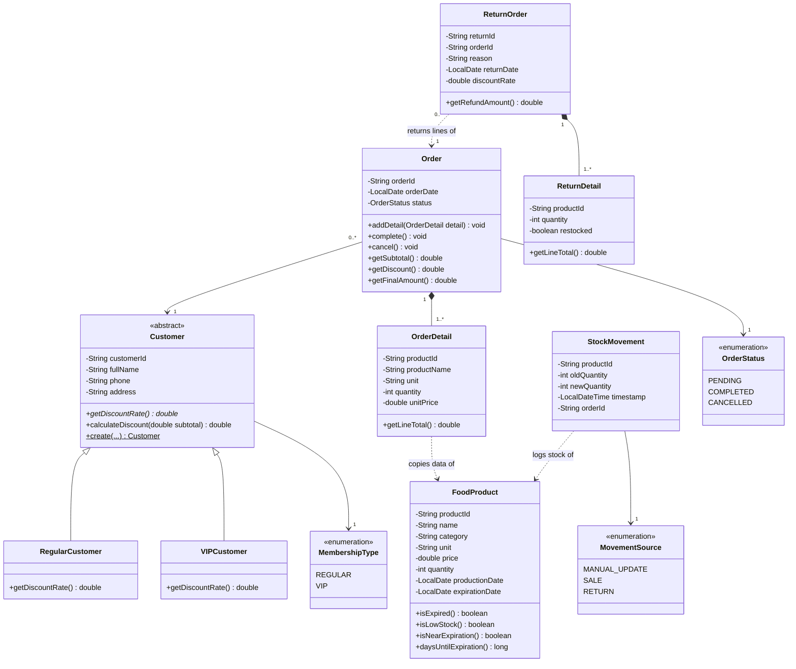

# Food Store Manager

> Java OOP console app to manage a food store: products, customers, sales, inventory and reports.


## About

Food Store Manager is a console-based application that helps a medium-sized food store manage its products, customers, sales transactions and inventory.

The project is developed as a Project-Based Learning (PBL) assignment at FPT University. It applies Object-Oriented Programming and Computational Thinking throughout the process, from requirements analysis and UML design to implementation.

## The Problem

The store currently tracks stock and sales by hand, which leads to three recurring issues:

- **Stock numbers drift**, so products run out unexpectedly
- **Expired products get sold**, causing health risks and complaints
- **Totals are calculated wrong**, leading to revenue loss and disputes

This system aims to solve all three by keeping inventory accurate, blocking expired items at checkout and computing every total automatically.

## Scope

The application covers five areas:

| Area | Description |
|---|---|
| Food Products | Manage product information, prices, stock and expiration dates |
| Customers | Manage customer information and Regular or VIP membership |
| Sales | Create transactions, apply membership discounts, confirm sales and handle returns |
| Inventory | Update stock automatically, keep a stock history and alert on low-stock or expiring items |
| Reports | Daily and monthly sales, best-selling products, top customers, low-stock and expired items |

## Our Approach

The system is designed using the four pillars of Computational Thinking:

| Skill | How it is applied |
|---|---|
| **Decomposition** | Break the store into five modules, each with a clear responsibility |
| **Abstraction** | Keep only the data that supports business rules and leave out the rest |
| **Pattern Recognition** | Identify the shared CRUD pattern across products, customers and orders |
| **Generalization** | Build class hierarchies so new customer types can be added without rewriting logic |

## UML Class Diagram



<sub>Getters, setters and constructors are omitted for readability. All stored classes implement `Serializable`.</sub>

### Relationships

| Relationship | Type | Meaning |
|---|---|---|
| RegularCustomer, VIPCustomer → Customer | Inheritance | Each subclass overrides the discount rate (0% and 10%). Changing a membership replaces the object with the other subclass. |
| Order → Customer | Association | Each order belongs to one customer. A customer can have many orders. |
| Order ◆ OrderDetail | Composition | An order contains one or more lines. Lines cannot exist without their order. |
| OrderDetail ⇢ FoodProduct | Dependency | A line copies the product ID, name, unit and price at sale time. It does not hold the product. |
| ReturnOrder ◆ ReturnDetail | Composition | A return holds the returned lines of one order. |
| StockMovement ⇢ FoodProduct | Dependency | Every stock change is logged with its source (manual update, sale or return). |

### Design Highlights

- **Single source of truth.** Inventory lives in the `quantity` field of `FoodProduct`, and reports are calculated from completed orders and returns.
- **Snapshots.** `OrderDetail` keeps the product name, unit and price, and a completed `Order` keeps the customer name, membership and discount rate. Past invoices stay correct when products or customers change later.
- **Polymorphic discount.** `Customer` is abstract and each subclass defines its own discount rate, so a new tier only needs a new subclass.
- **Immutable IDs.** IDs are `final` with no setter, and are normalized (trimmed, upper case) so `p01` and `P01` are the same.
- **Protected collections.** The lines of an order can only be added through `addDetail()`. External code receives a copy, never the original list.
- **Layered architecture.** `view`, `controller`, `service`, `repository` and `model` each have one job. See [docs/01.STRUCT_PROJECT.md](docs/01.STRUCT_PROJECT.md).

## Key Business Rules

| Rule | Description |
|---|---|
| Unique IDs | Product and customer IDs are unique, case-insensitive and cannot be modified |
| Valid data | Price must be greater than zero and stock cannot be negative |
| Date check | Production date cannot be after the expiration date, and cannot be in the future |
| Phone check | 10 digits starting with 0, or +84 followed by 9 digits, and unique per customer |
| Stock check | Quantity sold cannot exceed available stock |
| Expiry check | Expired products cannot be sold |
| Pricing | Total = Sum of (Price x Quantity), Final = Total minus Discount |
| Membership | Regular customers get no discount, VIP customers get 10% |
| Returns | Refund = returned lines x (1 - discount rate of the order). Returned goods can be restocked |
| Safe delete | A product or customer that appears in a transaction cannot be deleted |
| Alerts | Low stock at 5 items or fewer, near expiry at 7 days or fewer |
| Revenue | Only completed transactions count toward revenue, net of returns |

## Getting Started

**Requirements:** JDK 8 or newer (the code targets Java 8).

**With NetBeans:** open the project and press Run (F6).

**From the command line** (in the project folder):

```bash
javac -encoding UTF-8 -d build/classes src/*.java src/*/*.java
java -cp build/classes Main
```

## Data Storage

Data is saved automatically in the `data/` folder as **binary files** (Java serialization): `products.dat`, `customers.dat`, `orders.dat`, `returns.dat` and `stock_movements.dat`. They are created on first save, read again on the next start and are not tracked by Git. Delete the files to start from empty data. Details are in [docs/07.DATA_FILE_FORMAT.md](docs/07.DATA_FILE_FORMAT.md).

## Documentation

| File | Content |
|---|---|
| [docs/01.STRUCT_PROJECT.md](docs/01.STRUCT_PROJECT.md) | Folder structure, layers and conventions |
| [docs/02.SOLID_PRINCIPLES.md](docs/02.SOLID_PRINCIPLES.md) | SOLID principles with examples |
| [docs/03.FLOW_USING_GIT.md](docs/03.FLOW_USING_GIT.md) | Team Git workflow in NetBeans |
| [docs/07.DATA_FILE_FORMAT.md](docs/07.DATA_FILE_FORMAT.md) | How data is saved to files |

## Future Development

Ideas beyond the course:

- More membership tiers such as Silver, Gold and Platinum
- Promotions, vouchers and seasonal discounts
- Supplier and purchase order management
- Database storage with MySQL or SQL Server
- Graphical interface with Java Swing or JavaFX
- Multi-user support with staff roles and permissions
- Barcode scanning for faster checkout

## Tech Stack

| Category | Technology |
|---|---|
| Language | Java 8 |
| IDE | Apache NetBeans 13 |
| Date & Time | `java.time` API |
| Storage | Java serialization (binary files) |
| Design | UML Class Diagram |
| Version Control | Git & GitHub |

## Team

**Group 06** · Class SE2113 · FPT University HCMC

| Member | Student ID |
|---|---|
| Phạm Hoàng Tuấn (Leader) | SE200947 |
| Nguyễn Thiện Nhân | SE211217 |
| Huỳnh Minh Trung | SE194701 |
| Dương Trọng Chánh | SE211578 |

**Lecturer:** Hồ Hoàn Kiếm

---

<p align="center">Group 06 · FPT University HCMC</p>